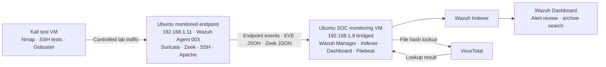
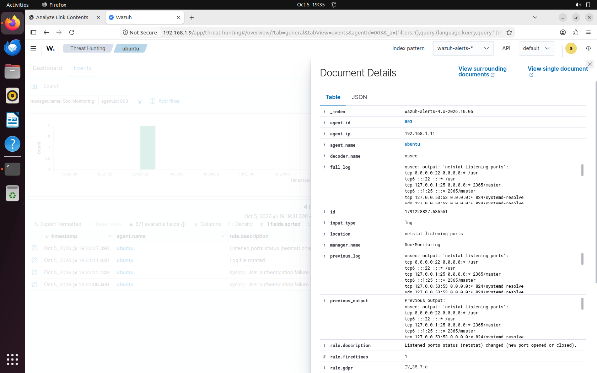
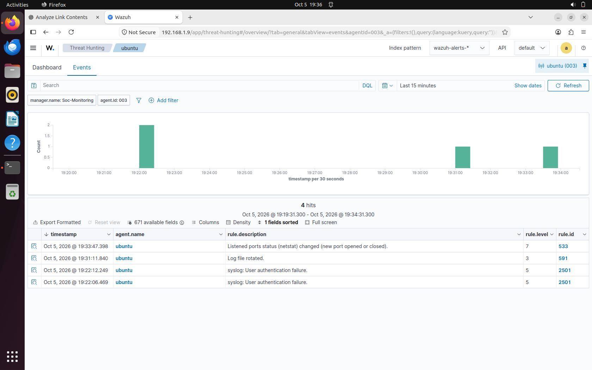
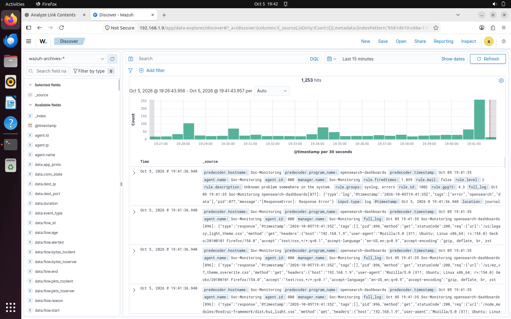

# Intelligent SOC Platform

**My SOC Level 1 portfolio project: a three-VM security monitoring lab.**

I contributed most of the work to building this lab with Alen. This repository is my personal portfolio presentation of the project, including the architecture, investigation workflow, results, and evidence. The system brings together Wazuh endpoint monitoring, Suricata network alerts, Zeek connection telemetry, real-time file integrity monitoring (FIM), and VirusTotal hash lookups. It demonstrates how I review endpoint and network evidence in a central SIEM, validate what an event supports, and explain what remains uncertain.

> **Credit:** I worked with **Alen** on the lab. The original project record and screenshots are from [Alen’s source repository](https://github.com/alen97mathew-gif/intelligent-soc-platform); I credit that source here. This is my portfolio repository and documents my work and investigation practice.

## What I practiced

- Confirming endpoint enrollment and investigating events for a specific Wazuh agent.
- Reviewing a custom SSH password-guessing detection and checking its context.
- Searching Suricata alerts and distinguishing sensor ingestion from an attack-specific signature.
- Searching Zeek connection records in archived telemetry, even when they do not trigger an alert.
- Validating a controlled file change through FIM.
- Interpreting a VirusTotal no-record response as unknown reputation, not as a clean verdict.
- Correlating timestamps, agent identity, addresses, and test activity without treating correlation alone as proof.

## Lab architecture

The recorded monitoring VM also had a separate NAT/indexer path at `10.0.2.15`; it is not another VM and is not interchangeable with the bridged address. Suricata and Zeek were installed on both Ubuntu roles. Sensor installation alone does not establish visibility of all traffic: capture interface, routes, and VM network topology determine what each sensor can see.

## Recorded lab roles

| Role | Recorded details | Purpose |
|---|---|---|
| Kali test VM | Kali IP not retained in the project record | Controlled Nmap, SSH password attempts, Gobuster, and reverse-shell-related exercises |
| Ubuntu monitored endpoint | `192.168.1.11`, Wazuh Agent `003`, dashboard name `ubuntu` | Endpoint monitoring and test target; Suricata, Zeek, SSH, and Apache |
| Ubuntu SOC monitoring VM | `192.168.1.9` bridged; `10.0.2.15` recorded on a separate NAT/indexer path; name `Soc-Monitoring` | Wazuh Manager, Indexer, Dashboard, Filebeat, Suricata, and Zeek |

Exact deployed versions, complete configuration exports, the Kali address, and a full port inventory were not retained. This repository is a project and investigation write-up, not a tested, one-command deployment package.

## Verified outcomes and evidence boundaries

| Exercise or component | Recorded result | What the result supports | What it does not establish |
|---|---|---|---|
| Endpoint enrollment | Agent `003` active at `192.168.1.11` | Endpoint enrollment and connectivity were verified | Fleet-scale coverage or continuous production availability |
| SSH password attempts | Custom Wazuh Rule `100100`, level 10, verified in controlled testing | A custom SSH brute-force detection was implemented and reviewed | A successful login, the rule’s exact correlation window, or measured accuracy; the final record does not retain the XML |
| Suricata | EVE JSON ingestion; Rule `86601` appeared in the integrated pipeline | Suricata event ingestion was demonstrated | Rule `86601` alone does not identify Nmap, a shell, or any specific attack |
| Zeek | JSON `conn.log` records ingested into Wazuh archives | Connection metadata was available for investigation | That every record becomes an alert, or that the retained archive screenshot isolates a shell connection |
| File integrity | Controlled edit to `/etc/soc-vt-test.txt` produced Rule `550` | FIM detected a checksum change on the test file | Malicious intent or coverage of every filesystem path |
| VirusTotal | Rule `87103`; message: “VirusTotal: Alert - No records in VirusTotal database” | A hash lookup returned a no-record response | A clean verdict, malware detection, or file-content upload |
| Port-state change | Rule `533` on Agent `003` during a reverse-shell-related exercise | The host reported a listening-port state change associated in time with the exercise | A reverse-shell signature, shell process, or command-and-control session |
| Nmap and Gobuster | Exercises were performed; associated telemetry was reviewed | The lab included network and web-enumeration investigation practice | A dedicated Nmap or Gobuster detection rule or retained terminal evidence |

These are qualitative lab outcomes. No detection rate, false-positive rate, ingestion latency, throughput, production hardening, or automated response capability is claimed. See [the investigation guide](docs/soc-l1-investigation-guide.md) for a repeatable analyst workflow and [evidence and attribution](docs/evidence-and-attribution.md) for the supporting source materials.

## SOC L1 investigation workflow

1. Confirm the expected endpoint is online. In this lab, the monitored host is Agent `003` at `192.168.1.11`.
2. Set the dashboard time range around the controlled exercise before searching.
3. Start in **Threat Hunting** and filter on the agent and relevant rule ID (for example, `100100`, `550`, `87103`, or `533`).
4. For Suricata, inspect the event’s signature and source/destination fields; `86601` by itself only supports that an integrated event was present.
5. For raw connection records, search **Discover** on `wazuh-archives-*`. Inspect the available field names before applying Zeek filters. An archive record is telemetry, not automatically an alert.
6. Correlate timestamp, endpoint identity, addresses, ports, and the test log. Treat temporal association as a lead; seek process or signature evidence before naming a specific attack.
7. Record the observed facts, the analyst interpretation, and the remaining uncertainty separately.

Example Zeek filter when the indexed schema supports it: `data.id.orig_h:"192.168.1.11"`. Add a destination address or port only after confirming it from the event; the project record does not preserve the Kali IP or a specific listener port.

## MITRE ATT&CK behavior mapping

These mappings describe exercised behavior; they are not certified coverage or Wazuh rule metadata.

| Lab behavior | Technique | Qualification |
|---|---|---|
| Nmap service probing | [T1046 — Network Service Discovery](https://attack.mitre.org/techniques/T1046/) | Behavior mapping; associated telemetry does not establish an attack-specific signature |
| SSH password attempts | [T1110.001 — Password Guessing](https://attack.mitre.org/techniques/T1110/001/) | Controlled authentication guessing with custom Rule `100100` |
| Gobuster directory enumeration | [T1595.003 — Wordlist Scanning](https://attack.mitre.org/techniques/T1595/003/) | Exercise performed; dedicated detection evidence is incomplete |

No ATT&CK technique is assigned to Rule `533` from a port-state change alone. FIM and hash reputation results are monitoring/enrichment outcomes and are not adversary techniques in these benign tests.

## Evidence gallery

The following original screenshots are included with their source credited. They show a port-change event detail, a Rule `533` event list, and a populated Wazuh archive view. The archive image does not isolate a Victim-to-Kali shell connection. Screenshots for Rules `550`, `87103`, and `100100`, Suricata ingestion, and the Nmap/Gobuster terminal exercises were not retained in the project gallery.

### Port-change event detail

### Rule 533 in Threat Hunting

### Populated Wazuh archive view

## Limitations and next steps

This is a single-endpoint lab with a consolidated monitoring server. High availability, fleet-scale deployment, sustained-load testing, automated containment, and production hardening were not demonstrated. Email alerting was deferred. A proposed Flask/SQLite application and custom frontend were abandoned and are not part of the completed architecture.

Possible follow-up work includes exporting sanitized configuration, capturing timestamped evidence for each use case, validating sensor visibility across the VM network, adding process-to-network correlation, applying HTTPS and access controls, and defining archive retention limits. These are future improvements, not completed features.

## Safety and secrets

Run scans, password attempts, and shell exercises only on systems you own or are explicitly authorized to test. The original lab used bridged networking, so keep targets clearly bounded; an isolated lab network is preferable for repeat testing. Protect Wazuh enrollment keys, passwords, certificates, and VirusTotal credentials. No credentials are included here. The original screenshots show an HTTP dashboard marked “Not Secure,” which is a lab limitation rather than production guidance.

## Resume-ready summary

> Built and investigated a three-VM SOC lab integrating Wazuh, Suricata, Zeek, and VirusTotal. Implemented and validated custom SSH password-guessing detection; investigated endpoint, network, FIM, and threat-intelligence events; and documented evidence boundaries, including the difference between archived telemetry and alerts.

**Skills practiced:** SOC investigation, SIEM, Wazuh, Linux, Ubuntu, Kali Linux, Suricata, Zeek, EVE JSON, Filebeat, endpoint monitoring, detection engineering, SSH authentication analysis, FIM, VirusTotal, threat-intelligence enrichment, network telemetry, MITRE ATT&CK, and evidence-based reporting.

## Project source and credit

- Original project and evidence: [alen97mathew-gif/intelligent-soc-platform](https://github.com/alen97mathew-gif/intelligent-soc-platform)
- Original project author listed in source README: Alen
- My contribution: shared most of the project work
- Collaborator and source credit: Alen; see the [original project repository](https://github.com/alen97mathew-gif/intelligent-soc-platform)
- Source documentation finalized: 6 October 2026

